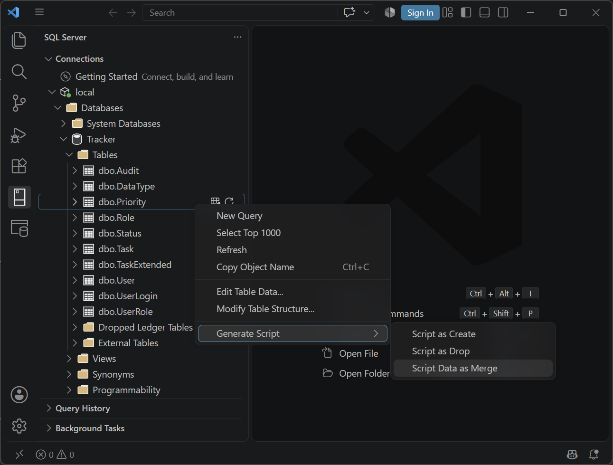
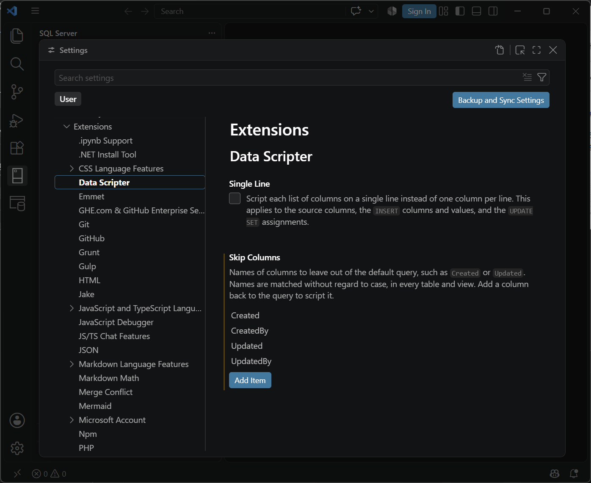

# Data Scripter

Visual Studio Code extension that generates a `MERGE` script for the data in a SQL Server table or view. It adds a **Script Data as Merge** command to the Object Explorer of the [SQL Server (mssql)](https://marketplace.visualstudio.com/items?itemName=ms-mssql.mssql) extension.



## Features

- **Scripts from the Object Explorer**: right-click a table or view to script its data as a single `MERGE` statement.
- **Repeatable scripts**: the `MERGE` inserts the rows that are missing and updates the rows that exist, so it can be run again and again, and reports the action taken for every row.
- **All or part of the data**: edit the query before it runs to filter the rows or change the columns that are scripted.
- **Choice of matching columns**: select the columns used to match existing rows, with the primary key or the identity column selected by default.
- **Identity and read-only columns**: identity values are kept with `SET IDENTITY_INSERT`, and computed, `rowversion` and generated always columns are left out.
- **Skipped columns**: leave columns such as `Created` or `Updated` out of the default query with the `dataScripter.skipColumns` setting.
- **Values by data type**: text, dates, numbers and binary values are scripted to insert the same value under every language and regional setting.
- **One row per line**: line breaks and tabs in a value are scripted as character codes, which keeps the script easy to read and compare.
- **Compact layout**: script each list of columns on a single line with the `dataScripter.singleLine` setting.
- **Warning for cut-off values**: warns when a long value reached the size limit of the SQL Server (mssql) extension.

## Requirements

- Visual Studio Code 1.105 or later
- [SQL Server (mssql)](https://marketplace.visualstudio.com/items?itemName=ms-mssql.mssql) extension 1.47 or later

## Usage

1. In the SQL Server Object Explorer, right-click a table and select **Generate Script** > **Script Data as Merge**, or right-click a view and select **Script Data as Merge**.
2. Press <kbd>Enter</kbd> to script all data with the default query, or edit the query to script a subset of the data. The default query selects every column that can be inserted or updated, which leaves out computed, `rowversion` and generated always columns, and the columns of the `dataScripter.skipColumns` setting.
3. Select the columns used to match existing rows. The primary key is selected by default, or the identity column when there is no primary key.
4. The generated `MERGE` statement opens in a new editor tab.

Columns are left out of the part of the `MERGE` they cannot be written in: identity columns are inserted but not updated, and read-only columns are not scripted.

Every row of values is scripted on one line. Line breaks and tabs in a value are scripted as `CHAR` or `NCHAR` codes, such as `N'first' + NCHAR(13) + NCHAR(10) + N'second'`, which inserts the same value. A value with more than 254 parts is joined with `CONCAT` instead, because that many `+` operators can exceed the stack limit of SQL Server.

The SQL Server (mssql) extension only keeps the first 65,535 characters or bytes of a long value, and the first 2 MB of an `xml` value. Data Scripter warns when a value reached the limit, which is raised with the `mssql.query.maxCharsToStore` and `mssql.query.maxXmlCharsToStore` settings.

The first time the command runs, Visual Studio Code asks you to allow Data Scripter to use your SQL Server connections. Access can be revoked at any time from the Accounts menu.

## Sample Output

```sql
/* Table dbo.Priority Data */

MERGE INTO [dbo].[Priority] AS t
USING
(
    VALUES
    (1, N'High', N'High Priority', 1, 1),
    (2, N'Normal', N'Normal Priority', 2, 1),
    (3, N'Low', N'Low Priority', 3, 1)
)
AS s
(
    [Id],
    [Name],
    [Description],
    [DisplayOrder],
    [IsActive]
)
ON
(
    t.[Id] = s.[Id]
)
WHEN NOT MATCHED BY TARGET THEN
    INSERT
    (
        [Id],
        [Name],
        [Description],
        [DisplayOrder],
        [IsActive]
    )
    VALUES
    (
        s.[Id],
        s.[Name],
        s.[Description],
        s.[DisplayOrder],
        s.[IsActive]
    )
WHEN MATCHED THEN
    UPDATE SET
        t.[Name] = s.[Name],
        t.[Description] = s.[Description],
        t.[DisplayOrder] = s.[DisplayOrder],
        t.[IsActive] = s.[IsActive]
OUTPUT $action AS [Action];
```

## Settings



| Setting                    | Default | Description                                                                                                                                                                         |
| -------------------------- | ------- | ----------------------------------------------------------------------------------------------------------------------------------------------------------------------------------- |
| `dataScripter.singleLine`  | `false` | Script each list of columns on a single line instead of one column per line. This applies to the source columns, the `INSERT` columns and values, and the `UPDATE SET` assignments. |
| `dataScripter.skipColumns` | `[]`    | Names of columns to leave out of the default query, such as `Created` or `Updated`. Names are matched without regard to case, in every table and view.                              |

Skipped columns are only left out of the default query. Add a column back to the query to script it.

```json
{
  "dataScripter.singleLine": true,
  "dataScripter.skipColumns": ["Created", "CreatedBy", "Updated", "UpdatedBy"]
}
```

## Installation

Install [Data Scripter](https://marketplace.visualstudio.com/items?itemName=loresoft.data-scripter) from the Visual Studio Marketplace, or search for **Data Scripter** in the Extensions view.

The current release is also available to [download](https://github.com/loresoft/DataScripter/releases) as a .vsix file and can be installed by opening the Extensions view, selecting the **...** menu, and selecting *Install from VSIX...*

## Building

```
npm install
npm test
npm run package
```

Press <kbd>F5</kbd> in Visual Studio Code to launch the extension in an Extension Development Host.
